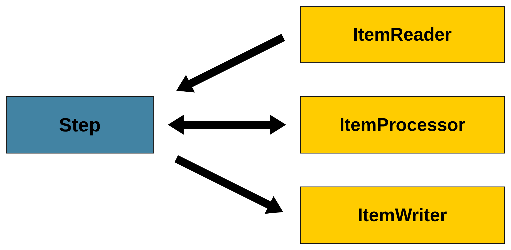
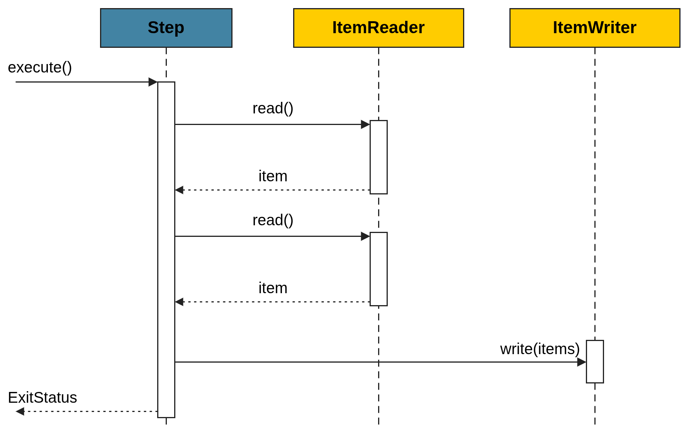
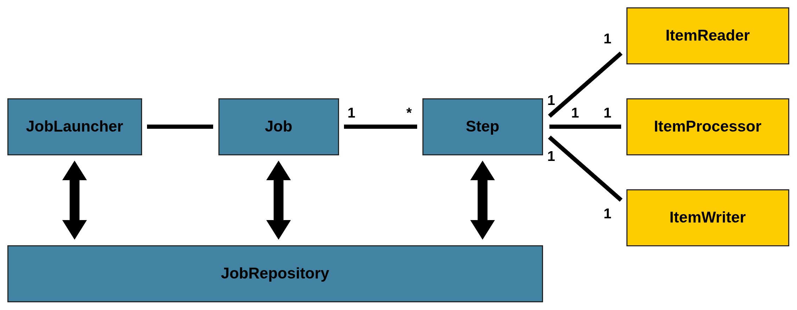
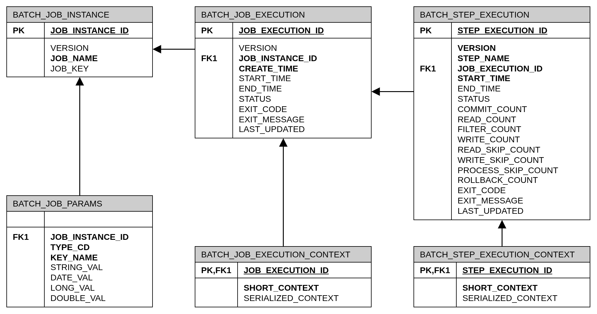

# Spring Batch와 함께 하는 TDD

2014-11-27

정상혁, KSUG ([www.ksug.org](http://www.ksug.org))

---

### 목차

1. 왜 Batch와 TDD인가?

2. Spring Batch는 무엇을 해 주는가?

3. 어떻게 응용했는가?

---

## 1. 왜 Batch와 TDD인가?

- 1.1 발표 동기
- 1.2 TDD
- 1.3 Batch
- 1.4 Batch + TDD

---

### 1.1 발표 동기

**급하게 준비**


사진 출처 : [http://blog.naver.com/khg2120/104069215](http://blog.naver.com/khg2120/104069215)

---

### 1.1 발표 동기

**그리고 통합 주제에 대한 동경**


---

### 1.2 TDD

<div style="display:flex; gap:40px; align-items:flex-start">
<div style="flex:1">

**나는 왜 TDD를 하는가?**

- 재미, 집중
- 디버깅 시간을 줄이려고

참고 : 내가 생각하는 TDD [https://blog.benelog.net/2766714.html](https://blog.benelog.net/2766714.html)

</div>

</div>

사진 출처 : [http://www.flickr.com/photos/titicat/2986232393/](http://www.flickr.com/photos/titicat/2986232393/)

---

### 1.2 TDD

**웹개발 TDD는 늘 아쉬웠다**

- Java 이외의 언어 부분은 검증 비용이 크다
  - SQL, javascript
- UI 테스트는 어렵다
  - Java 입장에서 html, javascript는 그냥 문자열이다
  - 실행코드와 검증코드의 거리가 멀어지기 쉽다
  - 플래쉬, 브라우저 호환성 등까지 검증하려면…
- 많은 오류는 javascript 같이 검증하기 어려운 곳에서 발생한다.

---

### 1.3 Batch

**Batch 모듈은**

- 복잡도가 높은 코드(super method가 흔함)
- 결과 확인과 재현에 큰 비용
- 오류 복구에 큰 비용
- 테스트 환경 구성의 어려움
- 결국 부분적인 테스트가 더욱 중요

---

### 1.3 Batch

**어떤 Batch의 테스트 경험**

<div style="display:flex; gap:40px; align-items:center">
  
  
</div>

사진 출처 : [http://www.imageafter.com/](http://www.imageafter.com/)

---

### 1.4 Batch + TDD

**Batch를 TDD로 개발한다면?**

- 전체 코드를 돌리기 전에 더 일찍 오류 발견
  - 덜 기다린다!
- Java 테스트 코드만으로도 더 많은 영역을 검증
- Testable한 구조로 만들다 보면
  - 알아보기 쉬워지고
  - 변경에 유연해짐

- 다양한 조건의 데이터를 쉽게 검증

---

## 2. Spring Batch는 무엇을 해 주는가?

- 2.1 문제 해결 주제
- 2.2 개별 작업 영역
- 2.3 작업 처리 인프라
- 2.4 활용예

---

### 2.1 문제 해결 주제

**Batch 개발에서 이런 목소리가 들린다면?**

- XML을 읽는데 힙메모리가 모자라요
- DB에 있는 건들을 메모리에 다 올릴 수가 없어요
- 배치가 도는 동안 테이블에 락이 걸려요
- 배치 실행 이력을 관리하고 싶어요
- 실패한 처리는 중간부터 다시 돌리고 싶어요
- 운영 환경에 올리기 전에는 테스트할 수 없어요

---

### 2.1 문제 해결 주제

**Spring Batch 제공 기능**

- 대용량 처리에 적합한 구조
  - Jdbc cursor, Jdbc batchUpdate
  - StAX, Stream 방식의 파일 처리
- 구조 추상화
- 이력 관리
- 이벤트 처리

- 구성요소의 역할이 구분되어 있어서 테스트 코드 짜기에 좋다!

---

### 2.2 개별 작업 영역

**Pipe & Filters**

- Bulk data processing을 위한 구조
- Chunk 단위로 운반하면서 흘려 보냄



---

### 2.2 개별 작업 영역

**구성 요소**

- Job
- Step
- Tasklet
- ItemReader (Extract)
- ItemProcessor (Transform)
- ItemWriter (Load)

---

### 2.2 개별 작업 영역

<div style="display:flex; gap:40px; align-items:flex-start">
<div style="flex:1">

**처리 흐름**

- ItemProcessor는 선택적

</div>

</div>

---

### 2.2 개별 작업 영역

**대표적인 ItemReader, ItemWriter**

- DB, XML, FlatFile

| 자원 | reader | writer |
| --- | --- | --- |
| DB | JdbcCursorItemReader | JdbcBatchItemWriter |
| Flat file | FlatFileItemReader | FlatFileItemWriter |
| Xml file | StaxEventItemReader | StaxEventItemWriter |

---

### 2.2 개별 작업 영역

**대표적인 ItemReader, ItemWriter**

- DB, XML, FlatFile

| 자원 종류 | read/writer | 자원 위치 지정 | | Raw data <-> Object |
| --- | --- | --- | --- | --- |
| DB | JdbcCursorItemReader | datasource | sql | rowMapper |
| DB | JdbcBatchItemWriter | datasource | sql | itemSqlSourceProvider |

---

### 2.2 개별 작업 영역

**대표적인 ItemReader, ItemWriter**

| 자원 종류 | read/writer | 자원 위치 지정 | | Raw data <-> Object |
| --- | --- | --- | --- | --- |
| flat file | FlatFileItemReader | resource | | lineMapper |
| flat file | FlatFileItemWriter | resource | | lineAggregator |
| XML | StaxEventItemReader | resource | fragmentRootElementName | unmarshaller |
| XML | StaxEventItemWriter | resource | rootTagName | marshaller |

---

### 2.3 작업 처리 인프라

**JobRepository, JobLauncher**



---

### 2.3 작업 처리 인프라

**JobRepository 테이블스키마**



---

### 2.4 활용예

**설정의 예**

```xml
<job id="ioSampleJob"
        job-repository="jobRepository">
  <step id="step1">
    <tasklet>
      <chunk reader="gasStationDbReader"
             processor="gasStationNameFilter"

             writer="gasStationXmlWriter"

             commit-interval="10"/>
    </tasklet>
  </step>
</job>
```

---

### 2.4 활용예

**Demo**

---

## 3. 어떻게 응용했는가?

- 3.1 JavaConfig
- 3.2 실행 이력
- 3.3 Spring Batch 구조 활용

---

### 3.1 JavaConfig

**XML 설정의 단점 보완**

- @Configuration, @Bean 활용
- Compile Validation 범위 증가
- TDD와 궁합이 잘 맞았다
- XML과의 관계를 잘 드러내기 위해서는
  - Component-scan은 좁은 범위로
  - Spring IDE의 support
  - Convention
    - BaseBallDbComponentFactory

---

### 3.1 JavaConfig

**더 잘 읽히게 만들기 위해서는**

- XML과의 관계를 잘 드러내는 관례를 정하자
- Component-scan은 좁은 범위로
- Spring IDE의 support
- 이름과 package를 일관성 있게
- BaseBallDbComponentFactory

---

### 3.2 실행 이력

**운영에 도움이 됨**

- 작업 진행상황을 보고 운영환경의 문제 파악을 더 빨리한 경험
- 건수로 데이터 변경 추이 파악
- Log 파일보다 일괄적인 view

---

### 3.2 실행 이력

**Job의 성격에 따라 필요한지 고민**

- 많은 Job이 사용하거나, Commit interval이 짧으면 병목 가능성
- JobRepository를 정기적으로 삭제하는 배치를 돌리기도 함
- 자주, 짧게 도는 Job에는 큰 이득이 없음
- MapJobRepository 활용
  - 테스트, 단독 프로세스
- Option이 생겼으면
  - 실패한 건만 기록
  - Asynchronous JobRepository
    - [https://jira.springsource.org/browse/BATCH-1524](https://jira.springsource.org/browse/BATCH-1524)

---

### 3.3 Spring Batch 구조 활용

**프레임웍만 쓴다고 다 응용되는 건 아니다.**

- 처음 하는 사람은 Tasklet으로 많이 만듦
- 되도록 reader-writer 구조를 응용하는 것이 바람직
  - 이력관리와 테스트 용이성
  - 어떤 사람에게 배치는 1000라인짜리 메소드 하나, 어떤 사람에게는 배치는 Job, Step, Reader, Writer
- Transaction 처리를 혼동하는 사람이 많았다.
  - @Transactional을 습관적으로 넣음
  - 특별한 경우가 아니면 Transaction은 Spring Batch에 맡기는 것이 바람직

---

### 정리

**Batch 개발의 피드백 속도 높이기**

- TDD
  - 전체 실행 전에, 운영환경 전에 디버깅
  - 적절한 모듈화가 되어야 가능
- Spring Batch 기능
  - TDD에 용이한 구조
  - JavaConfig를 접목시켜서 Compile time validation을 높인 설정 가능
  - 이력 확인
    - 실행 환경의 상태를 더욱 빨리 파악
